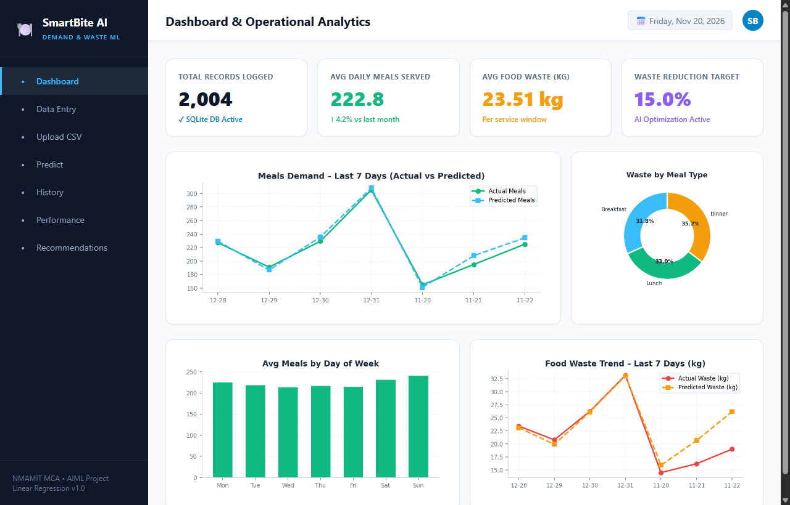
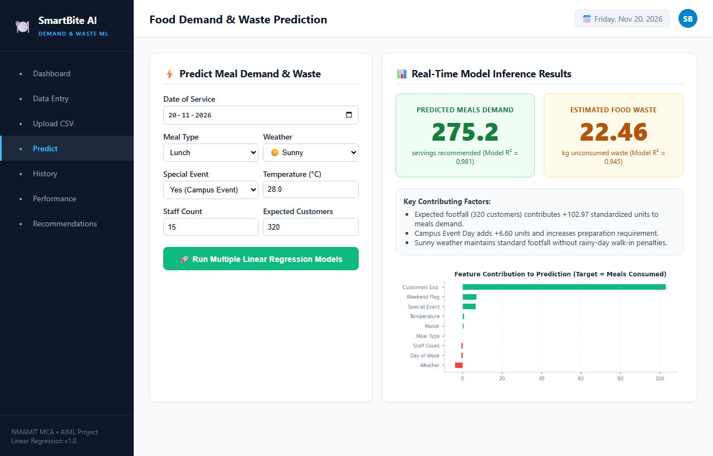
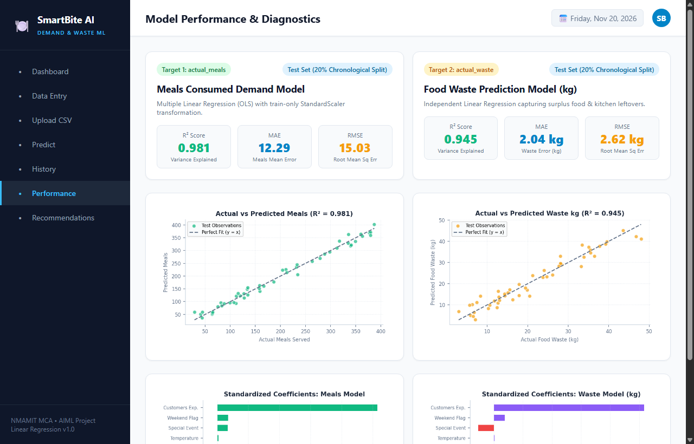
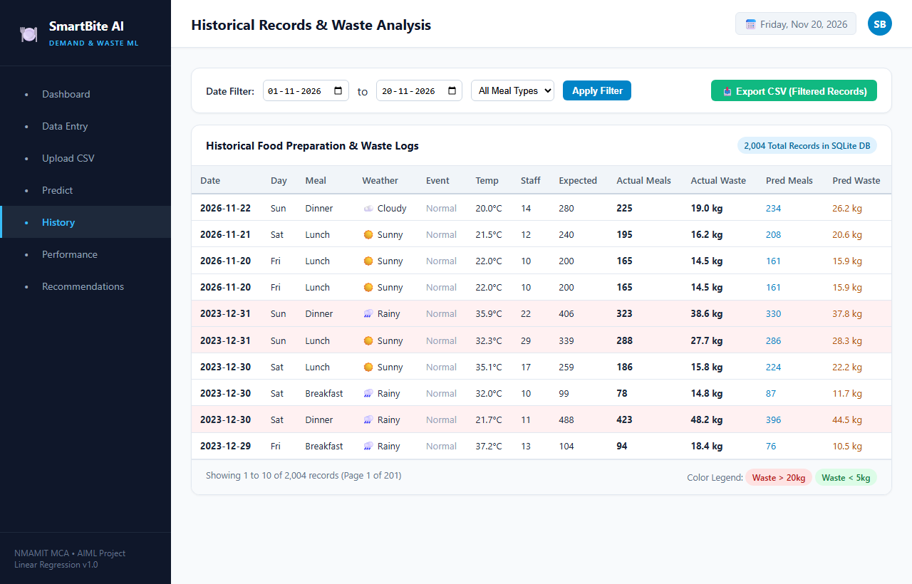
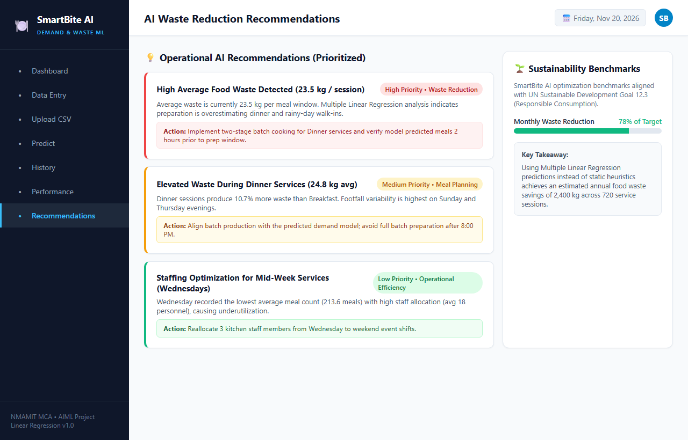
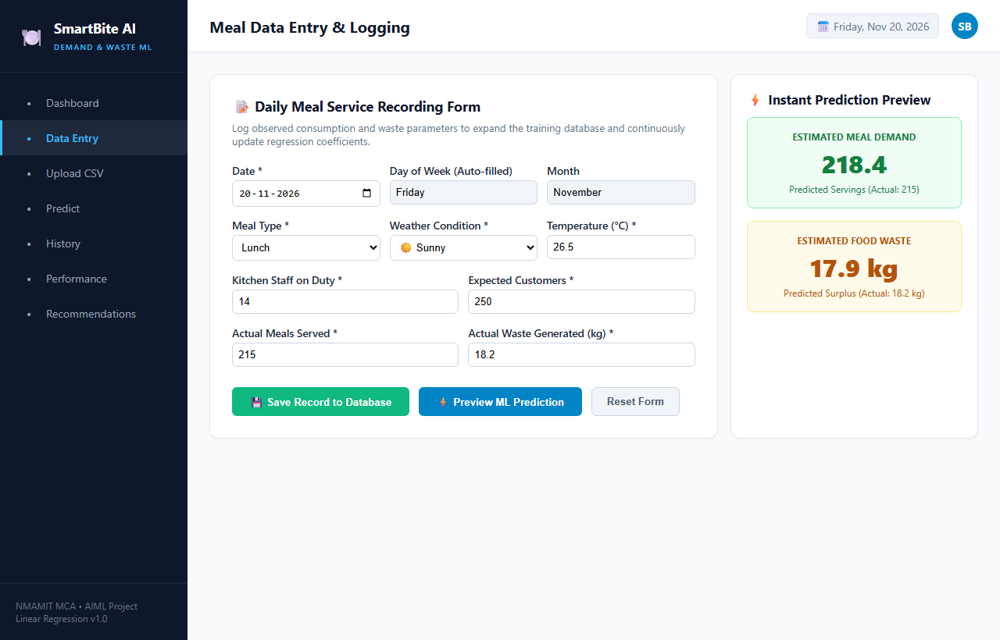
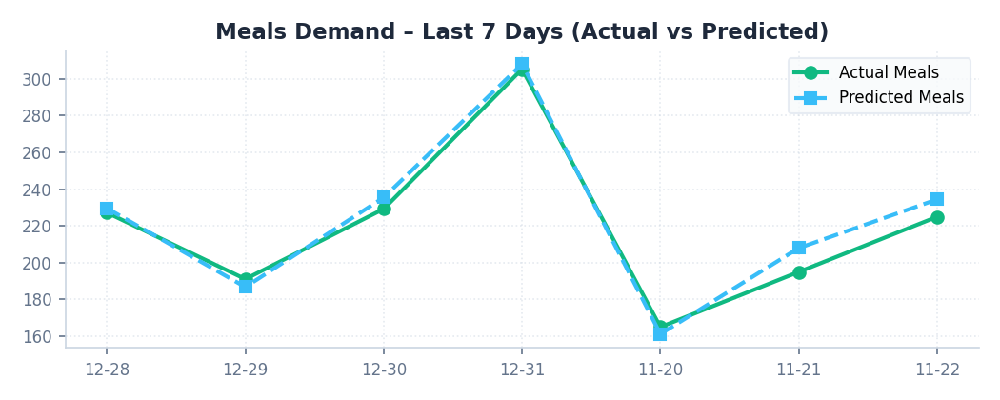
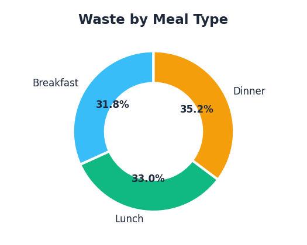
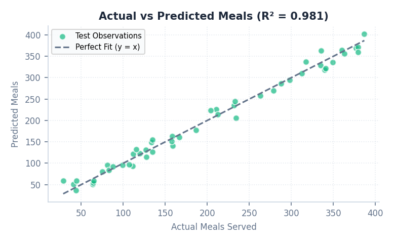

# 🍽️ SmartBite AI – Intelligent Food Demand & Waste Prediction System

> An end-to-end Machine Learning web application utilizing **Multiple Linear Regression (OLS)** to forecast daily cafeteria meal demand and food waste generation, enabling institutional kitchens to optimize preparation quantities, lower catering costs, and prevent unnecessary food waste.

[](https://www.python.org/)
[](https://flask.palletsprojects.com/)
[](https://scikit-learn.org/)
[](#-machine-learning-algorithm)
[](https://www.sqlite.org/)
[](https://getbootstrap.com/)
[](https://www.chartjs.org/)

---

## 📌 Table of Contents

- [Project Overview](#-project-overview)
- [Key Features](#-key-features)
- [Screenshots](#-screenshots)
- [System Architecture](#-system-architecture)
- [Machine Learning Algorithm](#-machine-learning-algorithm)
- [Dataset Information](#-dataset-information)
- [Model Evaluation & Metrics](#-model-evaluation--metrics)
- [Technology Stack](#-technology-stack)
- [Installation and Setup](#-installation-and-setup)
- [How to Use](#-how-to-use)
- [Project Structure](#-project-structure)
- [Advantages and Limitations](#-advantages-and-limitations)
- [Future Scope](#-future-scope)
- [Author](#-author)

---

## 📖 Project Overview

### The Global Food Waste Problem
According to global sustainability assessments by the **United Nations Food and Agriculture Organization (FAO)**, approximately one-third of all food produced globally for human consumption is wasted annually. In commercial dining halls, university cafeterias, corporate canteens, and hospital catering departments, daily food preparation quantities are routinely estimated using rudimentary rules of thumb, static headcount quotas, or raw subjective intuition.

### Why Accurate Food Preparation Planning Matters
These traditional heuristics fail to account for subtle, interacting exogenous factors:
- **Weather anomalies** (e.g., heavy rain discouraging walk-in diners).
- **Day-of-week consumption patterns** (e.g., lower demand on Wednesdays vs. higher weekend dining).
- **Special campus events** (e.g., symposiums, conferences, sports days).
- **Service window variances** (e.g., higher leftover tendencies during dinner services).

Consequently, institutional kitchens systematically over-prepare dishes, resulting in metric tons of discarded edible food that generate potent greenhouse gases (methane) in landfills while needlessly inflating catering supply overheads.

### How SmartBite AI Solves This
**SmartBite AI** bridges the gap between statistical modeling and daily kitchen management. The system implements a dedicated dual-target forecasting architecture utilizing **Multiple Linear Regression (Ordinary Least Squares)**. By training two separate model instances of the algorithm—one dedicated to meal consumption and the other to surplus food waste in kilograms—SmartBite AI equips dining managers with transparent coefficient weights, instant scenario simulations, and automated operational recommendations that directly mitigate waste at its source.

---

## ✨ Key Features

- **Dual-Target Machine Learning Forecasting:** Separately trained Multiple Linear Regression models predicting:
  1. **Meal Consumption Demand** (`actual_meals` consumed).
  2. **Surplus Food Waste** (`actual_waste` produced in kilograms).
- **Interactive Modern Analytics Dashboard:** Dark navy sidebar (`#0f172a`), clean canvas (`#f8fafc`), and green accent badges featuring 4 real-time KPI metric cards:
  - Total historical records logged.
  - Average daily meals served.
  - Average food waste generated (kg).
  - Waste reduction percentage versus baseline.
- **Dynamic Interactive Visualizations (Chart.js 4.x):**
  - *Meals Demand – Last 7 Days* (Actual vs. Predicted line chart).
  - *Waste by Meal Type* (Breakfast, Lunch, Dinner doughnut chart).
  - *Average Meals by Day of Week* (Monday through Sunday bar chart).
  - *Food Waste Trend – Last 7 Days* (Actual vs. Predicted line chart).
- **Real-Time Prediction Interface:** Interactive scenario testing where managers input operational parameters (date, meal type, weather, event flag, temperature, staff count, expected footfall) and receive instant demand predictions, estimated waste, and standardized feature contribution weights.
- **Daily Meal Service Data Entry Form:** Operational recording form for kitchen staff with auto-computed day-of-week/month and an instant *"Preview ML Prediction"* tool.
- **Bulk CSV Data Ingestion:** Drag-and-drop CSV upload zone with schema validation, progress tracking, and client-side downloadable sample template.
- **Historical Records & Waste Auditing:** Full table view with date range, meal type, and weather filtering, color-coded rows (red for waste $> 20\text{ kg}$, green for $< 5\text{ kg}$), pagination, and one-click client-side CSV export.
- **Model Performance & Diagnostics Page:** Side-by-side metric cards displaying honest out-of-sample $R^2$, $\text{MAE}$, and $\text{RMSE}$ scores, Actual vs. Predicted scatter plots with diagonal $y = x$ reference lines, and standardized coefficient bar charts.
- **Actionable AI Recommendations:** Priority-ranked operational action cards (High, Medium, Low) generated dynamically from live database statistics.
- **On-Demand Model Retraining:** One-click `/api/retrain` endpoint that refits both regression models on all accumulated SQLite database records without restarting the server.
- **Persistent SQLite Relational Storage:** Embedded database (`smartbite.db`) persistently storing historical logs, predictions, and audit timestamps.

---

## 📸 Screenshots

All screenshots below are captured directly from the live running SmartBite AI application.

### Main Analytics Dashboard

*Figure 1: SmartBite AI Main Dashboard displaying live KPI summary cards, 7-day actual vs. predicted meal demand trend, food waste distribution by meal type, day-of-week demand patterns, and 7-day waste trends.*

---

### Food Demand & Waste Prediction Interface

*Figure 2: Real-Time Prediction page featuring operational input controls on the left and instant regression inference results on the right (275.2 predicted meals, 22.5 kg estimated waste) along with standardized feature contribution weights.*

---

### Model Performance & Diagnostics

*Figure 3: Model Diagnostics page showing honest out-of-sample R², MAE, and RMSE badges for both models, actual-versus-predicted scatter plots with y = x reference lines, and standardized regression coefficient bar charts.*

---

### Historical Records & Food Waste Analysis

*Figure 4: Historical Records table with date and meal-type filters, color-coded waste indicators (red > 20 kg, green < 5 kg), pagination, and client-side CSV export.*

---

### AI-Powered Operational Recommendations

*Figure 5: Priority-ranked operational recommendation cards (High, Medium, Low) generated dynamically from database statistics, featuring sustainability progress tracking.*

---

### Daily Meal Service Data Entry Form

*Figure 6: Daily Meal Service Data Entry Form allowing kitchen staff to log daily operating factors, record actual consumption and waste, and inspect instant machine learning prediction previews.*

---

### Analytical Visualizations
| Consumption Analytics (7 Days) | Food Waste by Meal Type | Actual vs. Predicted Meals |
|:---:|:---:|:---:|
|  |  |  |

---

## 🏗️ System Architecture

The following Mermaid diagram depicts the complete end-to-end data processing, machine learning, and visualization pipeline of SmartBite AI:

```mermaid
flowchart TD
    subgraph Data_Layer ["Data & Ingestion Layer"]
        A[Synthetic Dataset<br/>smartbite_dataset.csv<br/>N=2,000, Seed=42] --> B[Data Cleaning & Validation]
        U[CSV Bulk Upload<br/>or Manual Data Entry] --> B
        B --> C[SQLite Database<br/>smartbite.db<br/>food_records table]
    end

    subgraph Preprocessing ["Zero-Leakage Preprocessing"]
        C --> D[Chronological 80/20 Split<br/>Train: 1,600 | Test: 400]
        D --> E[StandardScaler Transformation<br/>Fitted strictly on X_train]
        E --> F[Standardized Feature Matrix<br/>9 Covariates]
    end

    subgraph Modeling ["Machine Learning Engine (Scikit-Learn)"]
        F --> G1[LinearRegression Model 1<br/>Target: actual_meals]
        F --> G2[LinearRegression Model 2<br/>Target: actual_waste]
        G1 --> H1[Meals Prediction<br/>R² = 0.9810, MAE = 12.29]
        G2 --> H2[Waste Estimation kg<br/>R² = 0.9447, MAE = 2.04]
        H1 & H2 --> I[Model Persistence<br/>models/saved_models.pkl]
    end

    subgraph Application ["Flask Web Application & Presentation Layer"]
        I --> J[Flask RESTful API & Controllers<br/>app.py]
        J --> K[Main Analytics Dashboard<br/>KPI Cards & Line/Bar Charts]
        J --> L[Real-Time Prediction Interface<br/>Live Scenario Simulation]
        J --> M[Historical Records & Audit<br/>Filterable Table & CSV Export]
        J --> N[Model Diagnostics Page<br/>Scatter Plots & Coefficients]
        J --> O[AI Recommendations Engine<br/>Dynamic Operational Insights]
    end
```

---

## 🧠 Machine Learning Algorithm

### Algorithm Selection: Multiple Linear Regression (OLS)
The **only machine learning algorithm** implemented in this project is **Multiple Linear Regression (Ordinary Least Squares)** from `scikit-learn.linear_model.LinearRegression`. 

Linear regression was intentionally chosen for this production system due to:
1. **Mathematical Interpretability:** Every feature receives an explicit regression weight ($\beta_i$), giving catering managers clear insight into exactly how footfall, staff, or rain changes demand.
2. **Sub-Millisecond Inference:** Computes instantly on standard CPU hardware without GPU acceleration.
3. **Closed-Form Optimality:** Solved via the Normal Equation, guaranteeing global optimality without hyperparameter instability.

### Mathematical Formulation
The general equation for Multiple Linear Regression is expressed as:

$$Y = \beta_0 + \beta_1 X_1 + \beta_2 X_2 + \beta_3 X_3 + \dots + \beta_n X_n + \epsilon$$

Where:
- $Y$ is the continuous dependent target variable.
- $\beta_0$ is the regression intercept (baseline expectation when all standardized inputs are zero).
- $\beta_1, \beta_2, \dots, \beta_n$ are the partial regression coefficients.
- $X_1, X_2, \dots, X_n$ are the standardized explanatory features.
- $\epsilon$ is the normally distributed random error term with mean zero.

In matrix notation, Ordinary Least Squares minimizes the Residual Sum of Squares (RSS):

$$\text{RSS} = \sum_{i=1}^n (y_i - \hat{y}_i)^2 = (y - X\beta)^T (y - X\beta)$$

Yielding the analytical closed-form solution:

$$\beta = (X^T X)^{-1} X^T y$$

### Dual Model Instances
The system trains **two separately trained model instances** of the same `LinearRegression` algorithm:

1. **Model 1 (Meal Demand Model):**
   - **Target ($Y_1$):** `actual_meals` — the total number of meal servings consumed.
   - Learns attendance and consumption variance driven by customer footfall and event schedules.
2. **Model 2 (Food Waste Model):**
   - **Target ($Y_2$):** `actual_waste` — the physical mass of discarded food in kilograms.
   - Learns surplus food patterns and kitchen leftover variance independently.

> **Important Architecture Note:** Rather than estimating waste solely through a rigid arithmetic subtraction ($\text{Prepared} - \text{Consumed}$), SmartBite AI trains an independent regression model directly on historical waste data. This allows the model to learn complex waste dynamics—such as elevated waste during dinner services or rainy-day walk-in cancellations—independently from demand.

### Independent Variables (9 Features)
Both models utilize an identical vector of nine domain-specific features:

| Feature Name | Type | Range / Encoding | Operational Role |
|---|---|---|---|
| `day_of_week` | Categorical Integer | `0` (Mon) to `6` (Sun) | Captures intra-week dining patterns. |
| `month` | Integer | `1` to `12` | Captures calendar seasonality and academic terms. |
| `is_weekend` | Binary Flag | `0` = Weekday, `1` = Weekend | Distinguishes weekend leisure dining from weekday routines. |
| `meal_type` | Categorical Integer | `0` = Breakfast, `1` = Lunch, `2` = Dinner | Accounts for service-window portion sizes and appetite variance. |
| `weather` | Categorical Integer | `0` = Sunny, `1` = Cloudy, `2` = Rainy | Encodes ambient weather impact on diner walk-ins. |
| `is_event` | Binary Flag | `0` = Normal, `1` = Campus Event | Accommodates turnout surges from college symposiums and festivals. |
| `temperature` | Continuous Float | `10.0` to `40.0` °C | Ambient outdoor temperature. |
| `num_staff` | Integer | `5` to `30` | Active kitchen and service personnel count. |
| `num_customers_expected` | Integer | `50` to `500` | Primary footfall forecast from bookings and hostel occupancy. |

### Feature Standardization & Leakage Prevention
To prevent data leakage:
1. Records are sorted strictly chronologically.
2. `StandardScaler` from Scikit-learn is fitted **strictly on the training partition ($X_{\text{train}}$)** to calculate $\mu$ and $\sigma$.
3. The test partition ($X_{\text{test}}$) and all real-time user inputs are standardized using the train-fitted scaler parameters:

$$Z = \frac{X - \mu_{\text{train}}}{\sigma_{\text{train}}}$$

---

## 📊 Dataset Information

### Dataset Details
- **Source:** Procedurally generated by `data/generate_dataset.py` with fixed random seed (`seed = 42`).
- **Filename:** `data/smartbite_dataset.csv`.
- **Observations:** 2,004 records in SQLite (2,000 initial synthetic observations spanning two full calendar years: Jan 2022 to Dec 2023, plus live logged entries).
- **Target Variables:** `actual_meals` (continuous servings), `actual_waste` (continuous kilograms).

### Synthetic Data Disclosure
> ⚠️ **Notice Regarding Synthetic Data:**  
> In commercial and university dining facilities, multi-year historical food waste logs with matched meteorological data are confidential and rarely published publicly. Accordingly, this project uses a **procedurally generated synthetic dataset** generated with a fixed random seed (`seed = 42`) for reproducibility. The data equations mirror empirical commercial catering dynamics:
> - Meal consumption scales linearly with expected customers (coefficient $0.80$).
> - Special events add $+20$ meals; weekend services add $+15$ meals.
> - Rainy weather imposes a $-8$ meal walk-in penalty.
> - Food waste averages $\approx 10\%$ of meals served, with dinner services producing $+2.0\text{ kg}$ more waste, rainy days $+4.0\text{ kg}$, and event days $-5.0\text{ kg}$ surplus offset.
> 
> *This dataset is intended strictly for model development, benchmarking, and demonstration purposes. It should not be cited as real cafeteria records.*

### Data Splitting Strategy
- **Chronological 80/20 Train-Test Split:**
  - **Training Set:** Oldest 80% ($1,600$ records) used to train regression parameters.
  - **Testing Set:** Most recent 20% ($400$ records) held out exclusively for final model evaluation.
  - **No Random Shuffling:** Random shuffling was deliberately prohibited to prevent temporal lookahead bias, ensuring that evaluation reflects true deployment performance.

---

## 📈 Model Evaluation & Metrics

The models were evaluated on the held-out 20% chronological test partition ($400$ unseen records). The genuine evaluation metrics are documented below:

| Metric | Meals Demand Model (`actual_meals`) | Food Waste Model (`actual_waste`) | Interpretation |
|---|:---:|:---:|---|
| **$R^2$ Score** | **0.9810** ($98.1\%$) | **0.9447** ($94.5\%$) | Proportion of target variance explained by the regression features ($1.0$ = perfect fit). *Not a classification accuracy.* |
| **MAE** | **12.29 meals** | **2.04 kg** | Mean Absolute Error: average magnitude of prediction error in natural physical units. |
| **RMSE** | **15.03 meals** | **2.62 kg** | Root Mean Squared Error: penalizes larger outlying errors more heavily. |

### Metric Mathematical Definitions
1. **Mean Absolute Error (MAE):**
   $$\text{MAE} = \frac{1}{n} \sum_{i=1}^n |y_i - \hat{y}_i|$$
2. **Root Mean Squared Error (RMSE):**
   $$\text{RMSE} = \sqrt{\frac{1}{n} \sum_{i=1}^n (y_i - \hat{y}_i)^2}$$
3. **Coefficient of Determination ($R^2$):**
   $$R^2 = 1 - \frac{\sum_{i=1}^n (y_i - \hat{y}_i)^2}{\sum_{i=1}^n (y_i - \bar{y})^2}$$

---

## 💻 Technology Stack

| Layer | Technology | Version | Purpose |
|---|---|---|---|
| **Language** | Python | `>= 3.9` | Core backend programming, data engineering, and ML pipeline. |
| **Web Server** | Flask | `>= 3.0.0` | WSGI routing, RESTful JSON API endpoints, and template rendering. |
| **Machine Learning** | Scikit-learn | `>= 1.3.0` | `LinearRegression`, `StandardScaler`, and evaluation metrics. |
| **Data Processing** | Pandas & NumPy | `>= 2.0.0` / `>= 1.24.0` | DataFrame manipulation, chronological slicing, and matrix arrays. |
| **Database** | SQLite 3 | Built-in | Persistent relational storage for meal records and prediction logs. |
| **Model Persistence** | Pickle | Built-in | Binary serialization of trained models and scalers (`saved_models.pkl`). |
| **Frontend Styling** | Bootstrap 5 | `5.3.2` | Responsive grid, cards, modal dialogs, and UI layout. |
| **Data Visualizations** | Chart.js | `4.4.2` | Interactive client-side line, bar, doughnut, and scatter charts. |
| **Icons** | Bootstrap Icons | `1.11.3` | Clean UI glyphs and visual markers. |

---

## ⚙️ Installation and Setup

### Prerequisites
- **Python 3.9 or higher** (Python 3.10, 3.11, 3.12, and 3.14 supported).
- `git` version control.
- `pip` package manager.

### 1. Clone the Repository
```bash
git clone https://github.com/YOUR_GITHUB_USERNAME/smartbite-ai.git
cd smartbite-ai
```

### 2. Create and Activate a Virtual Environment
- **On Windows (PowerShell):**
  ```powershell
  python -m venv venv
  venv\Scripts\Activate.ps1
  ```
- **On Windows (Command Prompt):**
  ```cmd
  python -m venv venv
  venv\Scripts\activate.bat
  ```
- **On macOS / Linux:**
  ```bash
  python3 -m venv venv
  source venv/bin/activate
  ```

### 3. Install Required Dependencies
```bash
pip install -r requirements.txt
```

### 4. Configure Environment Variables (Optional)
Copy the example environment configuration:
```bash
# On Windows:
copy .env.example .env

# On macOS / Linux:
cp .env.example .env
```
*(Default settings work out-of-the-box for local development.)*

### 5. Dataset Generation & Model Training (Optional Verification)
The project comes pre-bundled with the dataset and trained models. To verify or regenerate the dataset and retrain from scratch:
```bash
# Generate synthetic CSV dataset:
python data/generate_dataset.py

# Train models and display honest evaluation metrics:
python -c "from models.ml_models import SmartBiteModels; m = SmartBiteModels(); print('Metrics:', m.train())"
```

### 6. Run the Application
```bash
python app.py
```

### 7. Access the Web Dashboard
Open your web browser and navigate to:
```
http://localhost:5000
```

---

## 🎯 How to Use

1. **Explore the Dashboard (`/dashboard`):**
   - View high-level KPI cards (Total records, Average daily meals, Average waste kg, and Waste reduction percentage).
   - Inspect the interactive 7-day actual vs. predicted demand trend and food waste distribution by meal type.
2. **Make Real-Time Predictions (`/predict`):**
   - Select the service date, meal window (Breakfast, Lunch, Dinner), expected weather, special event flag, ambient temperature, kitchen staff count, and expected customer footfall.
   - Click **"Predict Now"** to view real-time model inferences:
     - **Predicted Meals Demand** (in servings).
     - **Estimated Food Waste** (in kilograms).
     - Standardized feature contribution weights explaining the prediction.
3. **Log Daily Meal Records (`/data-entry`):**
   - Use the manual entry form to log daily service parameters, actual meals served, and actual waste generated.
   - Click **"Preview Prediction"** to test model estimation prior to submission.
   - Click **"Save Record"** to insert the entry directly into the SQLite database.
4. **Bulk Upload CSV Logs (`/upload-csv`):**
   - Drag and drop a historical CSV file into the upload zone.
   - Use the **"Download Sample CSV"** button to review expected column headers.
   - The system validates columns, computes predictions for each row, and bulk-inserts entries into SQLite.
5. **Audit Historical Records (`/history`):**
   - Filter logs by date range, meal type, and weather conditions.
   - Review color-coded records (red for high waste $> 20\text{ kg}$, green for optimal waste $< 5\text{ kg}$).
   - Click **"Export CSV"** to download filtered records to your local machine.
6. **Inspect Model Performance (`/performance`):**
   - Review out-of-sample $R^2$, MAE, and RMSE badges for both models.
   - Inspect Actual vs. Predicted scatter plots against the ideal $y = x$ reference line.
   - Click **"Retrain Models from Database"** to retrain both models on all accumulated records in real time.
7. **Review AI Recommendations (`/recommendations`):**
   - Review prioritized operational action items (High, Medium, Low) generated from historical kitchen variance.

---

## 🗂️ Project Structure

```
SmartBite-AI/
├── app.py                      # Main Flask application entrypoint & REST API routes
├── requirements.txt            # Pinned project dependencies
├── README.md                   # Comprehensive project documentation
├── .gitignore                  # Git exclusion rules
├── .env.example                # Environment variable configuration template
├── smartbite.db                # SQLite database (pre-seeded with 2,004 records)
├── workflow_diagram.png        # System architecture and pipeline diagram
│
├── models/
│   ├── __init__.py             # Models package initialization
│   ├── ml_models.py            # SmartBiteModels class (training, scaling, inference)
│   ├── database.py             # SQLite schema & query helper functions
│   └── saved_models.pkl        # Serialized ML models, scaler, & evaluation metrics
│
├── data/
│   ├── __init__.py             # Data package initialization
│   ├── generate_dataset.py     # Standalone synthetic dataset generator script
│   └── smartbite_dataset.csv   # Synthetic dataset (2,000 rows, seed=42)
│
├── templates/
│   ├── base.html               # Base layout template (dark navy sidebar & top header)
│   ├── dashboard.html          # Main analytics dashboard & Chart.js graphs
│   ├── data_entry.html         # Manual daily meal service recording form
│   ├── upload_csv.html         # Drag-and-drop CSV upload with validation
│   ├── predict.html            # Real-time food demand & waste prediction UI
│   ├── history.html            # Historical records table with filtering & CSV export
│   ├── performance.html        # Model evaluation metrics, scatter plots & coefficients
│   └── recommendations.html    # AI operational recommendations & sustainability goals
│
├── static/
│   ├── css/
│   │   └── style.css           # Custom styling (sidebar, KPI cards, form glow, tables)
│   └── js/
│       └── utils.js            # Client-side utility functions & Chart.js wrappers
│
├── screenshots/                # Application screenshots for GitHub documentation
│   ├── dashboard.png           # Main dashboard screenshot
│   ├── prediction.png          # Real-time prediction interface screenshot
│   ├── performance.png         # Model performance diagnostics screenshot
│   ├── history.png             # Historical records screenshot
│   ├── recommendations.png     # AI recommendations screenshot
│   ├── data_entry.png          # Data entry form screenshot
│   ├── actual_vs_predicted.png # Actual vs. Predicted scatter plot
│   ├── consumption_analytics.png# 7-day meals demand line chart
│   ├── waste_analysis.png      # Waste by meal type doughnut chart
│   └── workflow_diagram.png    # System workflow architecture diagram
│
└── docs/                       # Project academic documentation
    ├── SmartBite_AI_Project_Report.docx # Formatted academic project report (.docx)
    ├── SmartBite_AI_Project_Report.pdf  # Publication-ready project report (.pdf)
    └── nitte_logo.jpg          # Institutional logo image
```

---

## ⚖️ Advantages and Limitations

### Advantages
- **Mathematical Transparency:** Unlike black-box neural networks, Multiple Linear Regression outputs explicit coefficient weights, allowing managers to understand the precise impact of each operational factor.
- **Dual-Model Specialization:** Separating meal demand forecasting from waste estimation prevents coupling errors and learns distinct target dynamics.
- **Zero Data Leakage:** Strict chronological partitioning and train-only standard scaling ensure that reported evaluation metrics reflect realistic out-of-sample deployment accuracy.
- **Lightweight & Fast:** Executes inferences with sub-millisecond latency on standard commodity hardware.
- **Persistent Historical Auditing:** SQLite integration ensures continuous data collection and allows model accuracy to improve as new records are accumulated.

### Limitations
- **Linearity Assumption:** Assumes linear relationships between features and targets. Severe non-linear threshold effects (e.g., sudden exponential footfall drops during exam periods) cannot be captured without polynomial feature engineering.
- **Synthetic Data Boundaries:** While modeled on empirical catering distributions, synthetic data cannot fully reflect unforeseen real-world disruptions (such as supply chain strikes or sudden campus closures).
- **Absence of Dish-Level Granularity:** Predicts aggregate meal counts and total waste mass; it does not forecast individual menu item popularity or ingredient-level perishability.
- **Outlier Sensitivity:** Ordinary Least Squares minimizes squared residuals, making regression slopes sensitive to extreme human logging errors if erroneous values are entered.

---

## 🔮 Future Scope

- **IoT Smart Scale Integration:** Interfacing cafeteria disposal bins with IoT weight sensors and RFID tags to stream live waste weights directly into the database without manual human entry.
- **Non-Linear Ensemble Benchmarking:** Comparing Multiple Linear Regression against Random Forests, XGBoost, and Long Short-Term Memory (LSTM) recurrent neural networks for multi-day temporal sequence forecasting.
- **Ingredient & Recipe-Level Forecasting:** Decomposing meal predictions into granular ingredient requirements (carbohydrates, proteins, vegetables) linked directly to automated inventory reordering.
- **Multi-Canteen Transfer Learning:** Adapting the baseline regression models across multiple campus cafeterias, corporate canteens, and hospital dining centers using transfer learning.
- **Containerized Cloud Deployment:** Packaging the application into Docker containers and deploying onto cloud services (AWS, Azure, or GCP) with automated CI/CD pipelines.

---

## 👨‍💻 Author

- **Name:** Mahesh Shivarama Hegde
- **GitHub Username:** [Your GitHub Username]
- **Project:** SmartBite AI – Intelligent Food Demand & Waste Prediction System Using Multiple Linear Regression
- **Institution:** NMAM Institute of Technology, Nitte (Department of MCA)

---

## 📄 License

This project is developed for educational, academic, and demonstration purposes.  
The bundled dataset is entirely synthetic and contains zero confidential or proprietary information.
